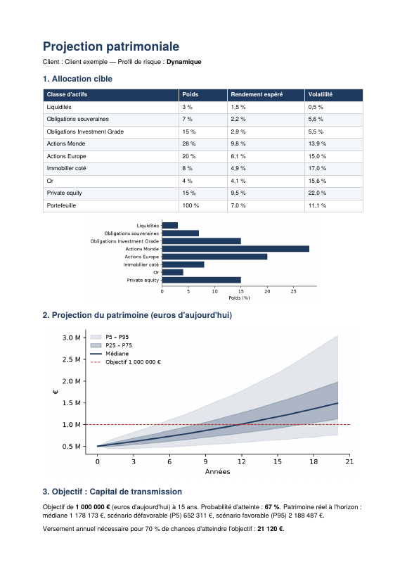
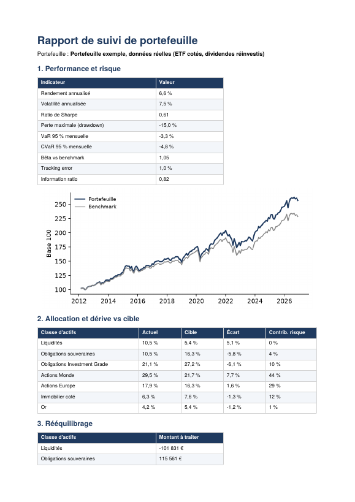
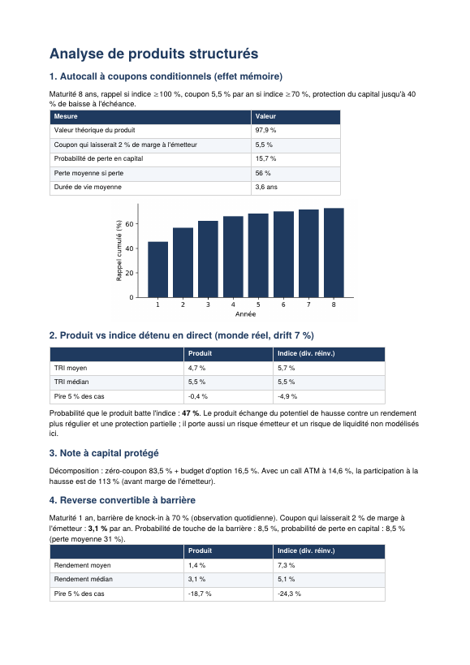

# wealth-toolkit

[](../../actions/workflows/tests.yml)

Boîte à outils Python de **gestion de patrimoine** : planification patrimoniale, suivi de portefeuille privé, produits structurés et fiscalité France / Monaco, avec une application web et des rapports PDF prêts à présenter à un client.

Projet personnel d'Amen Bedoui (MSc Banking & International Finance, TBS Education). 66 tests automatisés.

## Contenu

| Module | Question à laquelle il répond | Fonctions clés |
|---|---|---|
| `planner.py` | Quelle allocation, et mes objectifs sont-ils atteignables ? | profil de risque, allocation cible, projection Monte Carlo (versements, retraits, inflation, frais), probabilité d'atteinte d'un objectif, versement nécessaire |
| `portfolio.py` | Comment se comporte le portefeuille, faut-il rééquilibrer ? | rendement, volatilité, Sharpe, drawdown, VaR/CVaR, bêta, tracking error, contribution au risque, dérive vs cible, ordres de rééquilibrage avec bande de tolérance |
| `market_data.py` | Et sur de vraies données ? | téléchargement Yahoo Finance avec cache CSV, import CSV client (format français accepté), calibrage historique, rétrécissement vers des a priori de long terme |
| `backtest.py` | Comment les 4 profils auraient-ils évolué ? | rendement, volatilité, Sharpe, drawdown maximal, pire année civile complète |
| `tax.py` | Combien reste-t-il après impôt, et à la transmission ? | CTO, PEA, assurance-vie, résident monégasque ; droits de succession et donation France / Monaco ; paramètres datés et sourcés dans `tax_params.json` |
| `structured.py` | Que vaut ce produit structuré et que risque-t-on ? | autocall et Phoenix (coupon conditionnel, mémoire), reverse convertible à barrière, capital protégé, coupon « juste » pour une marge d'émetteur donnée, comparaison produit vs indice |
| `report.py` | Comment le présenter au client ? | 3 rapports PDF |
| `app.py` | Interface | application Streamlit à 4 onglets, export PDF |

## Installation et usage

```bash
pip install -e ".[dev]"
python -m pytest -q                 # 66 tests, sans accès réseau

python -m wealth fetch              # télécharge les cours réels (Yahoo Finance) dans data/
python -m wealth backtest           # backtest des profils + calibrage -> docs/backtest_results.md
python -m wealth demo --real        # 3 rapports PDF sur données réelles (sans --real : données simulées, étiquetées)
streamlit run app.py                # application web
```

```python
from wealth import planner, tax

w = planner.target_allocation(planner.risk_profile(15, 3, 2, 3))
paths = planner.project(w, planner.Scenario(500_000, 20_000), n_years=20)
planner.goal_probability(paths, planner.Goal("Transmission", 1_000_000, 15))
tax.inheritance_tax(500_000, "ligne_directe", residence="France")["droits"]
```

## Aperçu

| Projection patrimoniale | Suivi de portefeuille | Produits structurés |
|---|---|---|
|  |  |  |

Les PDF complets, générés avec les données réelles, sont dans `docs/examples/`.

## Données : ce qui est réel, ce qui est simulé

- **Réel** : `python -m wealth fetch` télécharge sept ETF cotés (Yahoo Finance, dividendes réinvestis), un par classe d'actifs : XEON.DE (liquidités), EUNH.DE (obligations souveraines euro), IEAC.AS (obligations d'entreprises euro), IWDA.AS (actions monde), EXSA.DE (actions Europe), IPRP.AS (immobilier coté), SGLD.L (or). La liste est modifiable dans `market_data.DEFAULT_TICKERS`.
- **Simulé** : seulement quand aucun cache réel n'existe (la démo sans `--real` et l'onglet « Suivi de portefeuille » en mode démo), et c'est alors indiqué. Les tests utilisent des données simulées ou des faux téléchargements, sans réseau.
- **Hypothèses** : les rendements, volatilités et corrélations de `data.py` sont des ordres de grandeur de long terme, pas des prévisions. Le private equity n'a pas de série de prix gratuite : il garde son hypothèse manuelle et est exclu du backtest.

## Résultats du backtest (données réelles)

Backtest des 4 profils sur **février 2012 → novembre 2026** (178 mois), rééquilibrage mensuel, sans frais ni fiscalité, sans private equity (poids renormalisés).

| Profil | Rendement annualisé | Volatilité | Sharpe | Drawdown max | Pire année |
|---|---|---|---|---|---|
| Prudent | 3,4 % | 5,0 % | 0,27 | -15,1 % | -14,2 % (2022) |
| Équilibré | 5,7 % | 7,0 % | 0,53 | -16,2 % | -14,3 % (2022) |
| Dynamique | 7,6 % | 8,8 % | 0,63 | -16,9 % | -14,5 % (2022) |
| Offensif | 9,1 % | 10,5 % | 0,68 | -18,0 % | -14,8 % (2022) |

Ce que ça montre : le risque et le rendement croissent avec le profil, mais **2022 touche tous les profils de façon presque égale** (-14 % à -15 %) : actions et obligations ont baissé ensemble quand les taux ont monté, donc la diversification actions/obligations n'a pas protégé cette année-là.

### Calibrage des hypothèses de marché

Hypothèses retenues = moyenne à 50 % de l'historique et à 50 % des a priori de long terme (rendements, volatilités et corrélations ; le rendement passé est un mauvais prédicteur : les actions ont rapporté environ 12,6 % par an sur la période, ce qui n'est pas une hypothèse raisonnable pour l'avenir).

| Classe | Rendement hist. | Vol. hist. | Rendement retenu | Vol. retenue |
|---|---|---|---|---|
| Liquidités | 0,5 % | 0,4 % | 1,5 % | 0,5 % |
| Obligations souveraines | 1,4 % | 5,1 % | 2,2 % | 5,6 % |
| Obligations Investment Grade | 1,8 % | 4,4 % | 2,9 % | 5,5 % |
| Actions Monde | 12,6 % | 12,4 % | 9,8 % | 13,9 % |
| Actions Europe | 9,2 % | 13,0 % | 8,1 % | 15,0 % |
| Immobilier coté | 3,9 % | 18,0 % | 4,9 % | 17,0 % |
| Or | 4,8 % | 16,2 % | 4,1 % | 15,6 % |

Reproduire : `python -m wealth fetch && python -m wealth backtest` (écrit `docs/backtest_results.md` et `data/calibration.json`). Ces hypothèses calibrées sont ensuite utilisées automatiquement par `demo --real` et par l'application. Les données du jour changent légèrement les chiffres.

## Méthode

- **Projection** : rendements annuels log-normaux multivariés, rééquilibrage annuel, frais déduits ; objectifs exprimés en euros d'aujourd'hui.
- **Fiscalité** : appliquée à la liquidation totale à l'horizon. Taux 2026 : flat tax 12,8 % d'impôt + 18,6 % de prélèvements sociaux (CSG relevée par la LFSS 2026), assurance-vie à 17,2 % de prélèvements sociaux, abattement de 4 600 € / 9 200 € après 8 ans, 7,5 % sur les produits liés aux primes inférieures à 150 000 €. Droits de succession en ligne directe : abattement de 100 000 € puis barème de 5 % à 45 %. Sources officielles dans `wealth/tax_params.json` (service-public.gouv.fr, impots.gouv.fr). **Barèmes validés au 24/11/2026** : à revalider à chaque loi de finances.
- **Produits structurés** : simulation risque-neutre (mouvement brownien géométrique, variables antithétiques) pour la valeur ; simulation en monde réel pour comparer le rendement du produit à celui de l'indice.

## Limites connues

- Fiscalité simplifiée : un seul contribuable, flat tax (pas de barème progressif de l'IR), pas de fiscalité au fil de l'eau, abattement d'assurance-vie utilisé une seule fois. Le cas d'un Français résidant à Monaco (imposé en France) n'est pas modélisé. Les paramètres monégasques sont une hypothèse à faire valider.
- Produits structurés : volatilité constante, pas de smile, pas de risque de crédit de l'émetteur ni de liquidité secondaire. Le TRI produit/indice est approximé (coupons non réinvestis).
- Le rendement passé est un mauvais estimateur du rendement futur : le calibrage est combiné à 50 % avec des a priori de long terme.
- Pas de coûts de transaction dans les rééquilibrages.
- Backtest : la dernière observation est un mois en cours (non clos) ; les ETF n'ont pas tous la même devise de cotation, donc les rendements ne sont pas tous exprimés en euros ; un seul ETF par classe d'actifs (risque de biais de sélection).
- Outil pédagogique : ne constitue pas un conseil en investissement ni fiscal.
